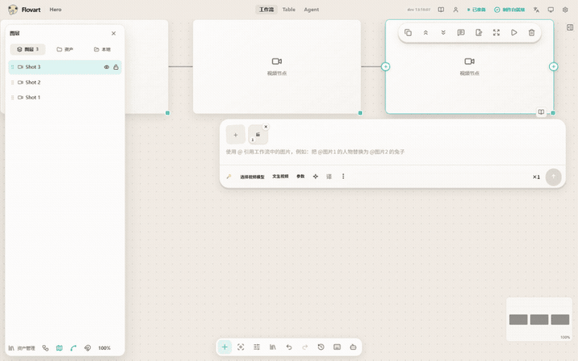
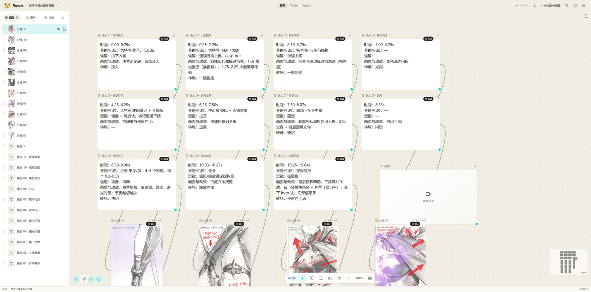
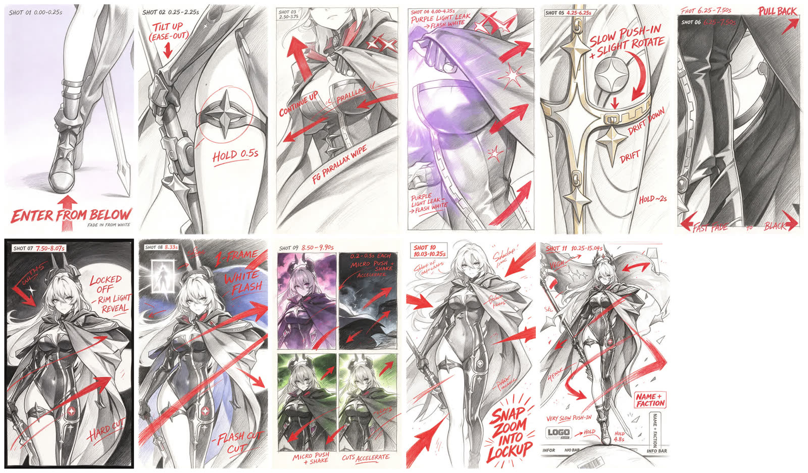
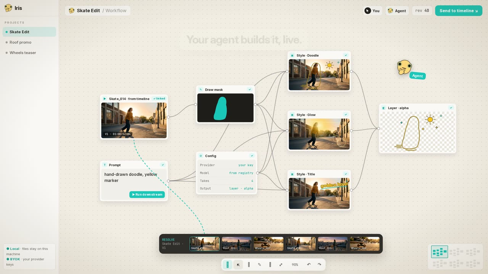

<!--
  README 草稿（2026-11-03）。不替换现有 README.zh-CN.md。
  规则：只写代码/测试/录屏能证明的内容；缺数据处用 TODO 标出，发布前必须清零。
  每条进 README 的录屏仍须在 DEMO_RECORDING.md 有复现记录。
-->

<h1 align="center">Flovart</h1>

<p align="center">
  <strong>让你的 Coding Agent 在可见画布上做分镜和生成。</strong>
</p>

<p align="center">
  一句指令，15 秒参考片 → 11 镜分镜，11 次生成，花费 <!-- TODO: 实测金额 --> X 元。<br />
  开源、本地优先、自带 Key。熟悉的无限画布 + Agent 交互，接你自己的 Codex / Claude Code / WorkBuddy。
</p>

<p align="center">
  <a href="./README.md">English</a> · 简体中文
</p>

<p align="center">
  <a href="https://avabbbb.github.io/Flovart/"><strong>在线体验</strong></a> ·
  <a href="https://github.com/avabbbb/Flovart/releases"><strong>下载预览版</strong></a> ·
  <a href="#案例">看案例</a> ·
  <a href="#当前状态与限制">当前状态</a>
</p>

<p align="center">
  
  <a href="https://github.com/avabbbb/Flovart"></a>
</p>

<!-- ① 主视觉：左 Agent 终端，右画布实时变化 -->
<p align="center">
  <!-- TODO: 用 user-attachments 方式上传的 mp4（≤ 10 MB）替换下面的 GIF；重排为左终端 / 右画布 -->
  
  <br />
  <sub>全程由 Agent 驱动，没有人工操作：节点与连线由 typed CLI 创建，画布同步更新。复现记录见 <a href="docs/archive/2026-10-07/maintenance/readme/DEMO_RECORDING.md">DEMO_RECORDING.md</a>。</sub>
</p>

## 安装

```bash
git clone https://github.com/avabbbb/Flovart.git && cd Flovart && npm install && npm run flovart:cli -- start --source --web --open
```

Flovart 免费开源，模型费用走你自己的 Provider 账户，不加价。不想装？先用[在线体验](https://avabbbb.github.io/Flovart/)或[桌面预览版](https://github.com/avabbbb/Flovart/releases)。

## 案例

### 案例 1：15 秒竖屏参考片 → 11 镜分镜

<table>
  <tr>
    <th width="50%">输入：参考片</th>
    <th width="50%">输出：画布上的分镜</th>
  </tr>
  <tr>
    <td><!-- TODO: 参考片 user-attachments 视频（确认授权） --></td>
    <td></td>
  </tr>
</table>



**怎么做的：** 外部 Agent 把参考片拆成 11 个镜头（时间、景别/机位、运镜、动效、转场），每镜一个文字节点；再用参考片抽帧做图生图。节点、图片和连线全部由 `workflow.node.create` / `workflow.connect` 创建，没有手动编辑。

| 项目 | 数值 |
| --- | --- |
| 模型 | RunningHub · Seedream 4.7（图生图） |
| 分辨率 | <!-- TODO --> |
| 生成次数 | 11 |
| 总花费 | <!-- TODO: 从设置「用量」页或 Provider 控制台取实测值 --> |
| 用时 | <!-- TODO --> |

Workflow 文件：<!-- TODO: examples/storyboard-11-shots/workflow.json --> · 复现记录：<!-- TODO: examples/storyboard-11-shots/README.md（从 archive 迁入） -->

### 案例 2：参考片 → 成片

<!-- TODO: 尚未制作。建议链路：锁点（角色/场景，批准后自动注入）→ 拆镜 → 批量生视频 → video.merge 按镜号拼接。
     表格同案例 1：输入/输出视频对照 + 模型、分辨率、次数、花费、Workflow 文件、复现记录。 -->

### 案例 3：无参考片，从一句话开始

<!-- TODO: 可选。没有成片就删掉本节，不要用概念片充数。 -->

## 拿来就能贴的指令

启动 Flovart 后，对你的 Coding Agent 说：

```text
打开 Flovart，把 ./ref.mp4 拆成分镜：每个镜头一个节点，写清时长、景别和运镜，再用参考片的帧生成对应分镜图。跑之前告诉我总费用。
```

```text
在 Flovart 里做一条 15 秒竖屏产品短片：先出产品主视觉让我确认，确认后拆 5 镜并批量生成，最后按镜号拼成一条。
```

```text
Open Flovart and turn ./ref.mp4 into a storyboard: one node per shot with duration, framing and camera move, then generate a frame for each shot. Tell me the total cost before running.
```

<!-- TODO: 每条指令发布前在 Codex 上实跑一遍，跑不通的删掉 -->

## 为什么是 Flovart

- **Agent 用类型化操作，不模拟鼠标。** `inspect · apply · node.run` 带 revision 与幂等键，不靠屏幕坐标。
- **人和 Agent 改的是同一张可见画布。** 没有隐藏副本，Agent 做的每一步你都看得见、改得了。
- **BYOK，不加价。** 用你自己的 Key 直连 Provider；批量生成一次确认费用，失败只重跑失败节点。
- **本地优先。** 项目、素材和生成历史保存在本机，Key 在本地加密保存。

## 画布交互：参考 LibTV 做的那些细节

我们很喜欢 [LibTV](TODO: 官网链接) 的画布 + Agent 创作体验，花了不少时间把它的交互机制在开源、本地、BYOK 的前提下重新实现了一遍。Flovart 是独立项目，与 LibTV 无关联，也未获其认可。

| 体验 | Flovart 里的实现 |
| --- | --- |
| `@` 引用任何节点和素材 | 媒体优先列表（最多 60 项），引用以 chip 显示并支持悬停预览；按 Tab 自动引用上游输入 |
| 节点里的大号提示栏 | 模型列表浮层、比例宫格、时长滑块、内联高级参数、有序参数摘要 |
| 360° 磁吸连线 | 连接点跟随光标，离开节点范围也能吸附 |
| 文本节点一键生资产 | 文档排版；从文本一键生成角色 / 场景 / 道具；可加入 Agent 上下文 |
| 脚本节点分镜表 | 每镜时长与运镜，高度自适应；镜号 / 时长 / 场景 / 机位 / 台词写进节点数据并校验 |
| 锁点 → 拆镜 | 角色 / 场景锁点在标题栏批准，批准后下游镜头自动带上参考图；未批准直接拦下 |
| 参数继承 | 新建 / 下游节点沿用模型与风格 |
| 批量宫格与历史 | 多张候选宫格对比，历史面板回看 |
| 自动截帧 / 音视频分离 | 生成后自动上画布，默认关闭，工具栏三个开关 |
| 按镜号拼成片 | `video.merge` 按镜号排序拼接；精修交给 Resolve |
| Skill 表单 + 自动模式 | 文本 / 图 / 视频 / 音频输入槽位；自动模式一次授权费用上限，超限重新确认 |
| Agent 活动与回执 | Agent 每一步操作和结果都有可查的回执面板 |

<!-- TODO: 给前 4 行各录一条 3–5 秒的小动图（@ 引用、提示栏参数面板、磁吸连线、文本生资产），录制记录补进 DEMO_RECORDING.md -->

**和 LibTV 的不同：** Flovart 开源（MIT）、项目和素材留在本机、用你自己的 Key、可以接你已经在用的 Coding Agent。<!-- 只写 Flovart 自己的事实，不写对方的缺点或未核实的定价 -->

## 功能导览

<details>
<summary>20 条真实操作录屏：画布、图片、视频、音频、外部 Agent</summary>

<!-- 从现有 README.zh-CN.md 「功能演示」整节搬入（pic/readme/features/*.gif），包括「尚未录制的模型能力」那句说明 -->

</details>

## 当前状态与限制

- **0.2.0 内测版。** Beta 路径只有 Codex CLI + Browser Workflow（Agent）与 RunningHub 图像 + 视频（Provider，待认证）；DaVinci Resolve、WorkBuddy、Claude Code、OpenCode、Gemini、OpenAI-compatible BYOK 等均为 Experimental。
- **安装包未签名。** Windows 会出现 SmartScreen 提示；macOS 为 ad-hoc 签名且未公证。
- **付费生成由 Provider 计费。** 生成中停止或刷新页面后，Provider 仍可能扣费。
- **Resolve 宿主层仍在开发。** P0 只做到 Add to Media Pool，不改原 Timeline。
- 部分生成错误提示目前只有中文。

兼容性与证据以 [Support Matrix](SUPPORT_MATRIX.md) 为唯一事实来源。

## 愿景

<p align="center">
  <a href="pic/readme/vision/Flovart_Vision_3min_v5.mp4">
    
  </a>
  <br />
  <sub><strong>概念片 / 设计目标，不代表今天已实现。</strong>片中的 Resolve 内 AI Layer 交互是我们的 North Star。</sub>
  <!-- TODO: 改用 user-attachments 视频；60 秒宣传片只保留一处或删除 -->
</p>

## 参与贡献

欢迎 Provider 适配、宿主集成和 Workflow 能力的贡献。请先提交 [Issue](https://github.com/avabbbb/Flovart/issues/new/choose)，阅读[贡献约定](.github/CONTRIBUTING.md)。感谢 [@labiaaaaaaaaa](https://github.com/labiaaaaaaaaa) 推进第三方服务适配。

## License

[MIT](./LICENSE)。Flovart 不内置模型服务，也不对生成内容主张知识产权；请自行确认模型、素材与生成结果的版权与合规。使用即表示同意[使用条款](./docs/TERMS_OF_SERVICE.md)和[隐私政策](./docs/PRIVACY_POLICY.md)。
