

  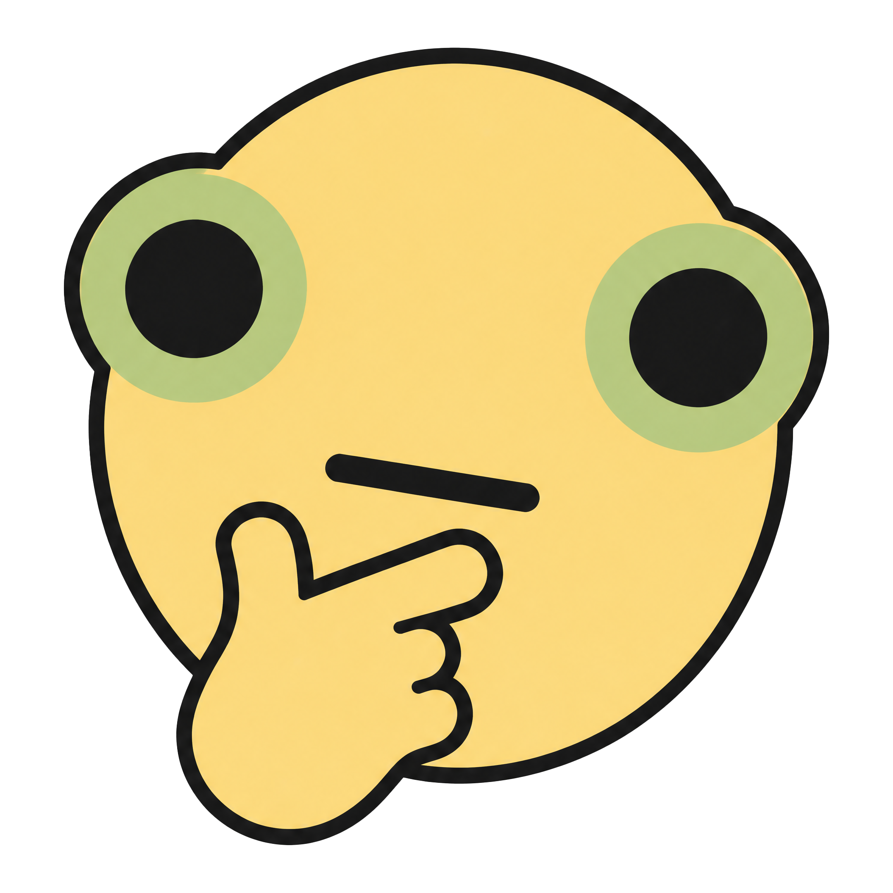

<h1 align="center">Flovart</h1>

  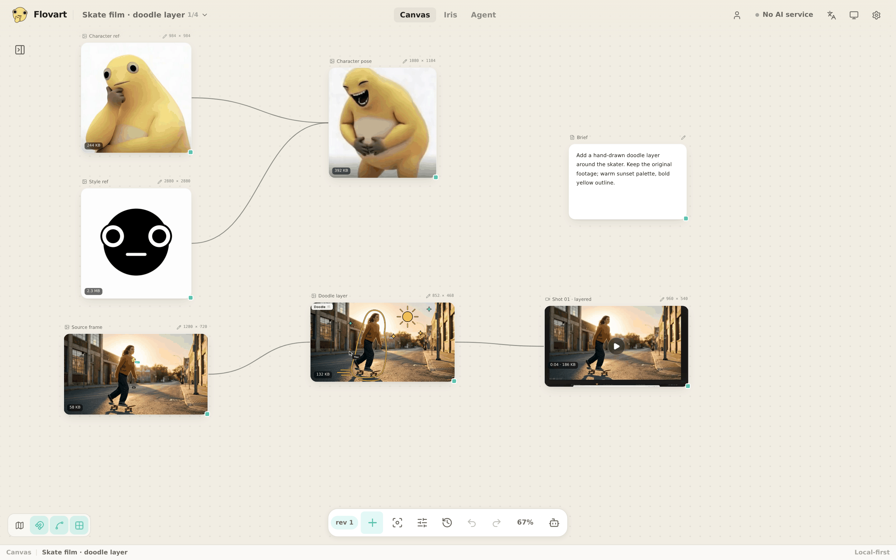

  
  
  

  
   
  README views · third-party counter, not unique visitors

## Feature tour

<table width="100%">
  <tr>
    <td width="50%" valign="top">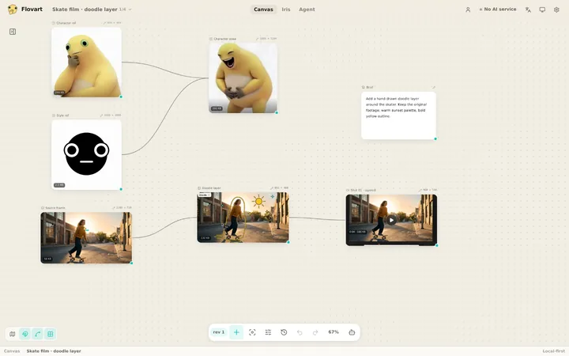 <b>Infinite canvas</b> — pan, zoom and drag nodes; connections follow.</td>
    <td width="50%" valign="top">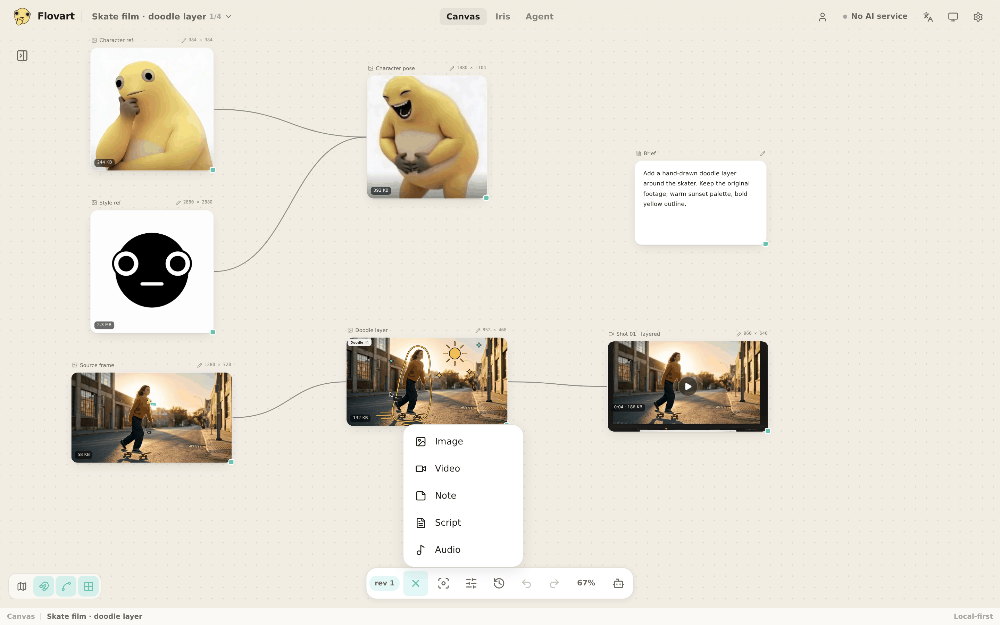 <b>Add any node</b> — double-click the canvas to create an image, video, note, script or audio-reference node.</td>
  </tr>
  <tr>
    <td width="50%" valign="top">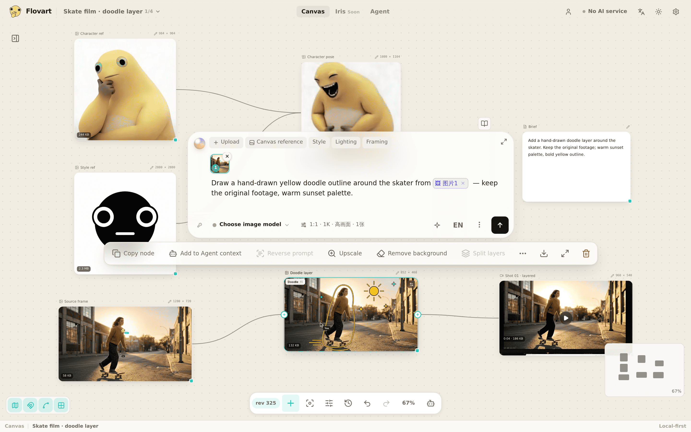 <b>Prompt on the node</b> — the composer @-mentions connected references; the node toolbar adds upscale, remove background and more.</td>
    <td width="50%" valign="top">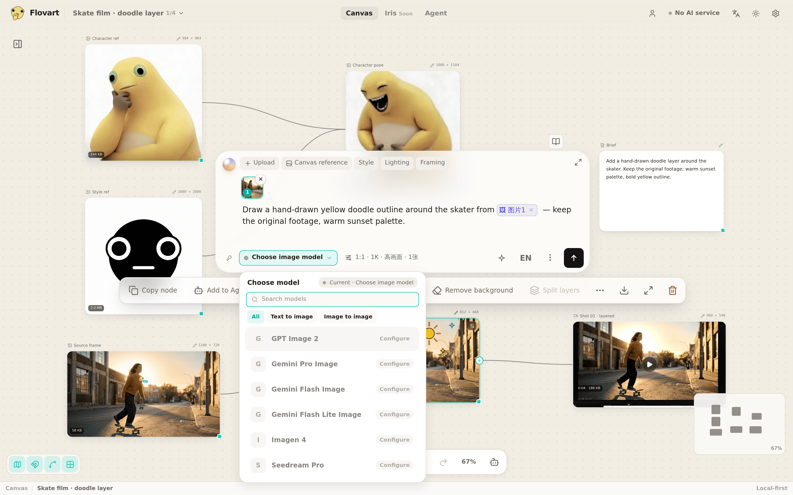 <b>Pick a model per node</b> — text-to-image and image-to-image models, configured with your own service.</td>
  </tr>
  <tr>
    <td width="50%" valign="top">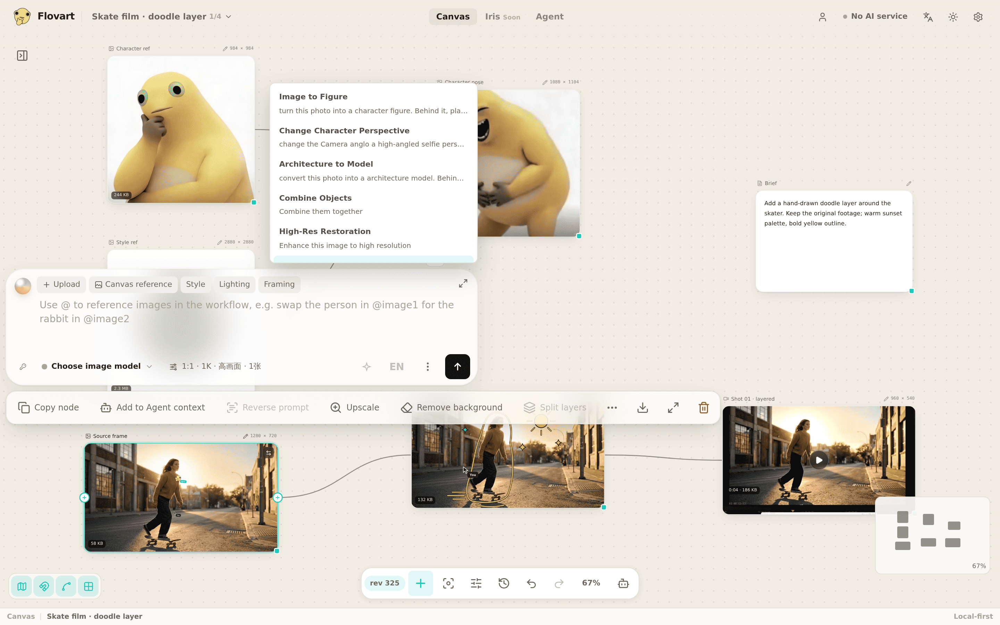 <b>Prompt library</b> — built-in edit recipes one click away from the composer.</td>
    <td width="50%" valign="top">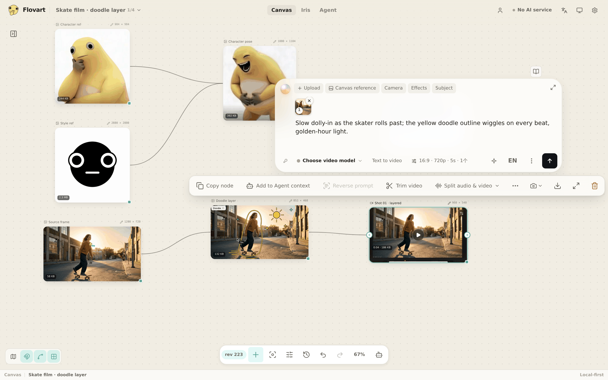 <b>Video nodes</b> — import clips, trim, split audio, and prompt a video model from the same canvas.</td>
  </tr>
  <tr>
    <td width="50%" valign="top">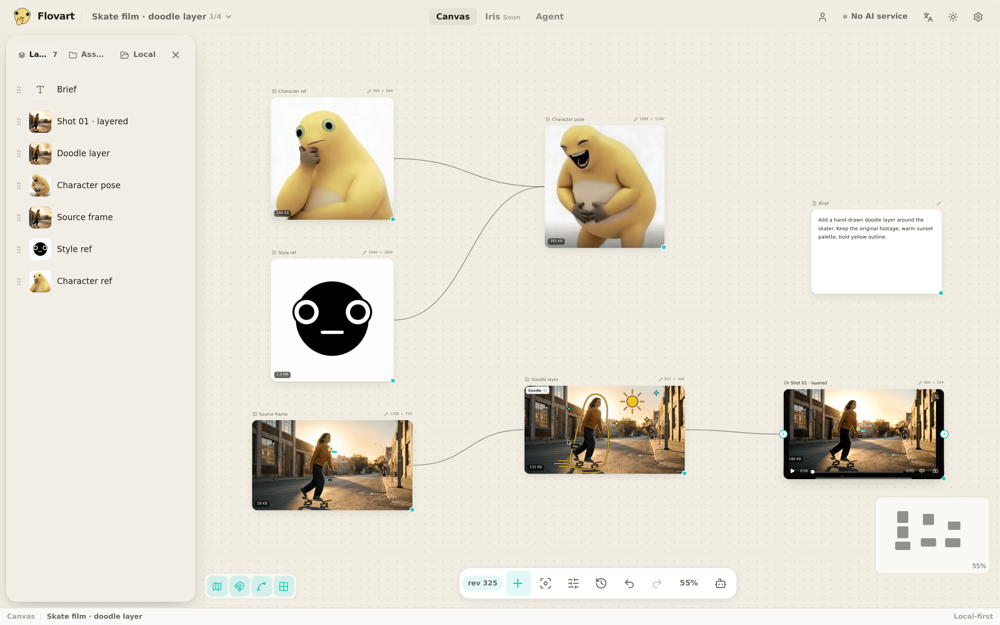 <b>Layers, assets, local folders</b> — every node listed and reorderable beside the canvas.</td>
    <td width="50%" valign="top">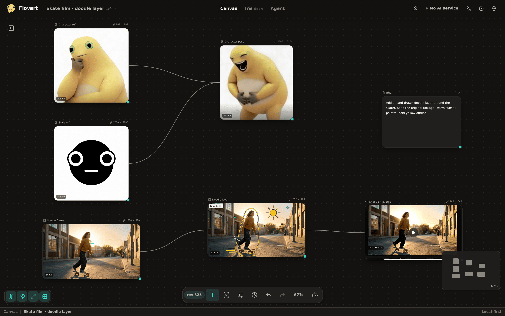 <b>Light and dark</b> — the same Workflow in the dark theme.</td>
  </tr>
  <tr>
    <td width="50%" valign="top">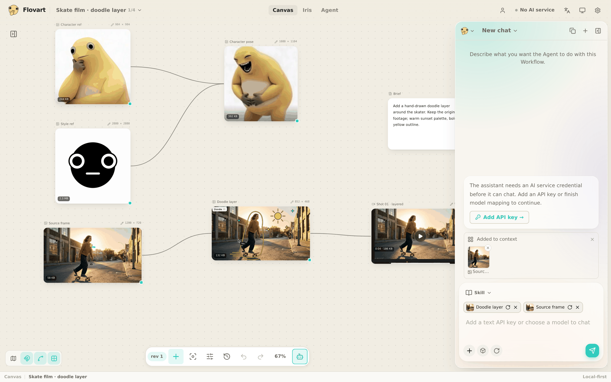 <b>Agent beside the canvas</b> — add selected nodes to context and brief the assistant.</td>
    <td width="50%" valign="top">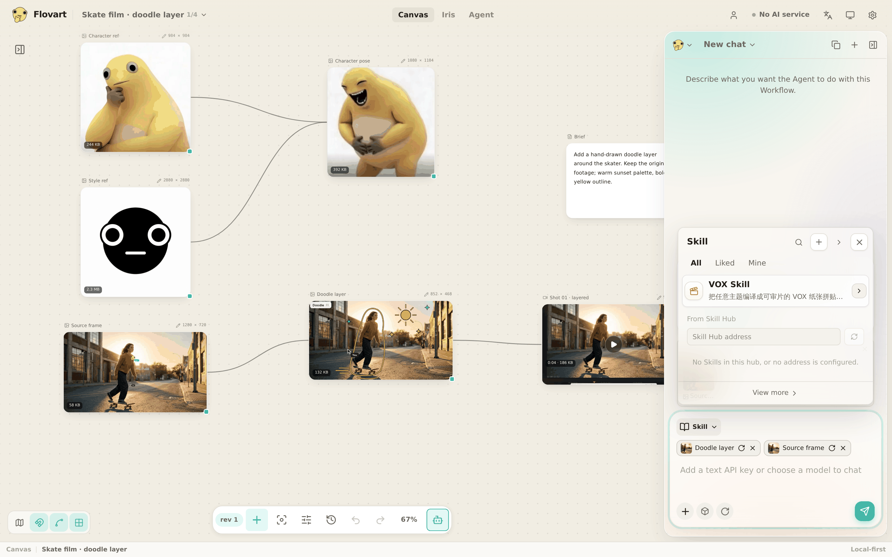 <b>Production Skills</b> — pick a Skill from the hub before you ask.</td>
  </tr>
  <tr>
    <td width="50%" valign="top">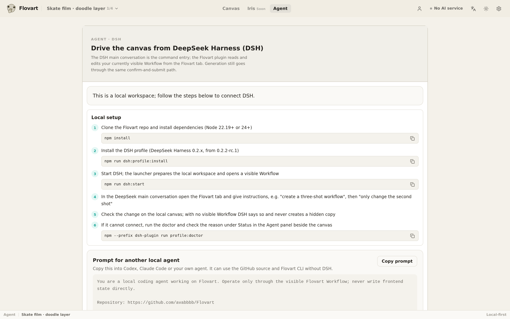 <b>Bring your coding agent</b> — connect DSH, Codex, Claude Code or your own agent through the Flovart CLI.</td>
    <td width="50%" valign="top">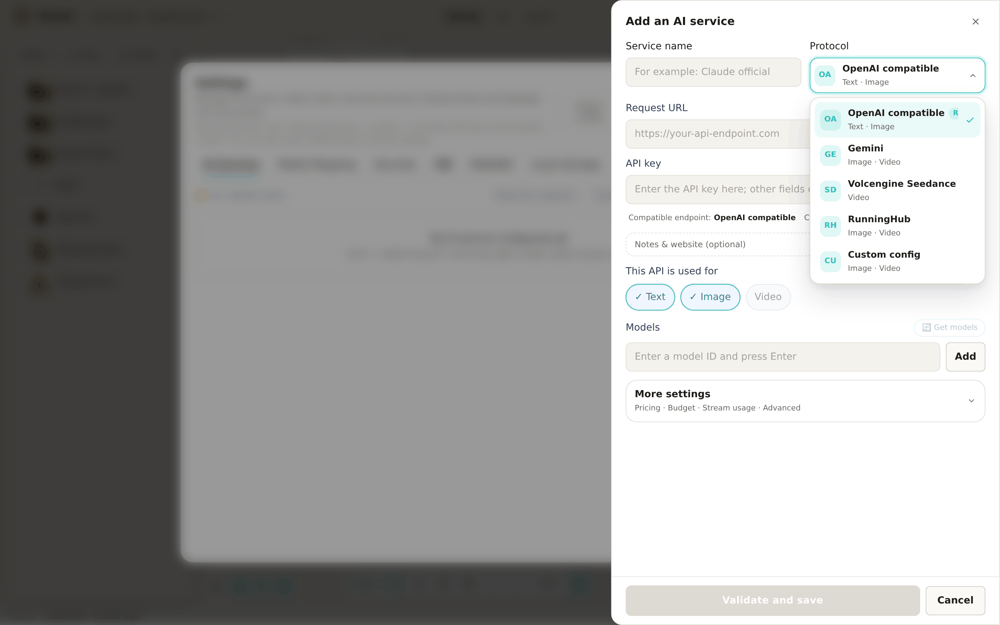 <b>Bring your own keys</b> — OpenAI-compatible, Gemini, Volcengine Seedance, RunningHub or a custom config.</td>
  </tr>
</table>

Screenshots: the web build with a demo Workflow assembled from images already in this repository. No AI service is configured and nothing on the canvas was generated for these shots.

The canonical English README is now [README.md](./README.md). The Chinese version is [README.zh-CN.md](./README.zh-CN.md).
