<h1 align="center">Flovart</h1>

<p align="center">
  <strong>Your footage. Plus one layer.</strong>
</p>

<p align="center">
  Open-source, local-first Workflow + Agent creative tool. The DaVinci Resolve Studio 21.1 host layer is in development (Experimental).<br />
  Keep your edit in the host, let your Agent understand the context, and let Flovart handle generation, references and durable candidates.
</p>

<p align="center">
  English · <a href="./README.zh-CN.md">简体中文</a>
</p>

<p align="center">
  <a href="https://avabbbb.github.io/Flovart/"><strong>Try live demo</strong></a> ·
  <a href="https://github.com/avabbbb/Flovart/releases"><strong>Download preview</strong></a> ·
  <a href="docs/overview/quick-start.en.md">Get started</a> ·
  <a href="SUPPORT_MATRIX.md">Compatibility</a>
</p>

<p align="center">
  
  
  
  
  <a href="https://github.com/avabbbb/Flovart/releases"></a>
  <a href="https://github.com/avabbbb/Flovart"></a>
</p>

<p align="center">
  <a href="stats/README.md"></a>
  <br />
  <sub>README views · third-party counter, not unique visitors</sub>
</p>


## Watch the 60-second concept film

[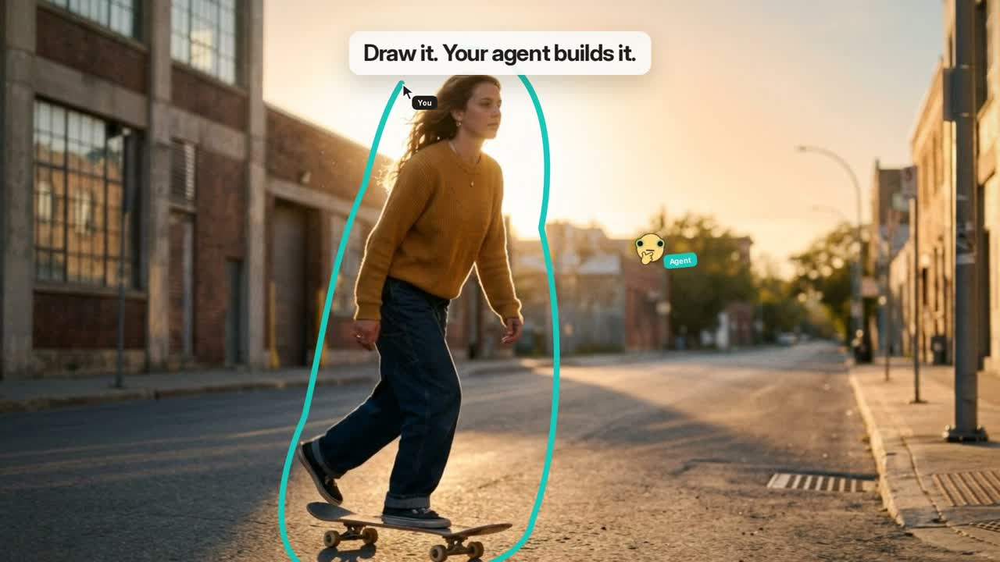](https://github.com/avabbbb/Flovart/raw/refs/heads/main/pic/readme/vision/Flovart_Promo_60s_v4.mp4)

**Keep the original. Describe the change. Compare candidates.** Flovart brings your coding Agent and a visible creative Workflow together. Canvas handles multi-step work, Table handles batches, and Agent connects your preferred assistant.

The film shows the Resolve-first design target: point at a frame, generate creative layers, compare takes, and return an approved result. **Concept film, recorded before the Flovart name was restored; its closing card still says Iris.** Native host integration and alpha-layer/new-track output remain experimental or planned. Today, the recorded Agent → Workflow operations below are the verified starting point; Resolve P0 targets explicit **Add to Media Pool**.

**0.2.0 closed beta:** Windows EXE and macOS DMG builds are distributed through [Releases](https://github.com/avabbbb/Flovart/releases). Platform builds are tested separately; installers do not certify creative-host or paid-provider support. See the [Support Matrix](SUPPORT_MATRIX.md).

## See Flovart in action

The 60-second Flovart promo cut:

<p align="center">
  <video src="pic/readme/vision/Flovart_Promo_60s_v4.mp4" controls muted width="720"></video>
  <br /><sub><strong>Promo cut v4.</strong> 60 seconds · <a href="pic/readme/vision/Flovart_Promo_60s_v4.mp4">source file</a></sub>
</p>

<p align="center">
  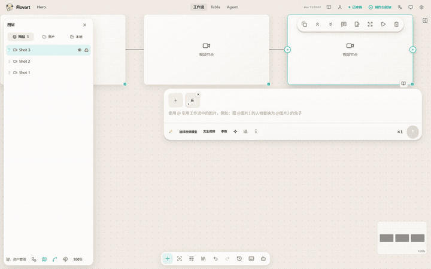
  <br />
  <sub><strong>The current recorded Agent/Workflow surface — natural language becomes nodes and edges.</strong><br />
  Nothing in this clip is done by hand: the agent (WorkBuddy codebuddy) drove the visible Workflow through the typed
  CLI surface, creating three nodes and two connections live, with no source edits. No generation step was run, so no
  paid model service was called. The Resolve-native MCP → candidate → Media Pool Hero remains an External Gate and is deliberately not presented here as finished. Reproduction record: <a href="docs/archive/2026-10-07/maintenance/readme/DEMO_RECORDING.md">DEMO_RECORDING.md</a>.</sub>
</p>


## Product vision — the interaction we're building toward

<p align="center">
  <a href="pic/readme/vision/Flovart_Vision_3min_v5.mp4">
    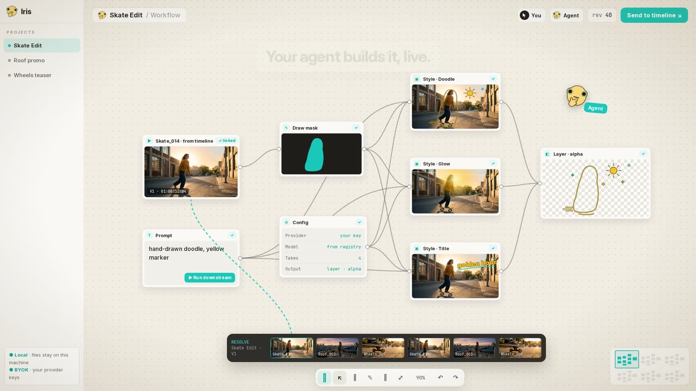
  </a>
  <br />
  <sub><strong>Flovart Vision · 3 minutes.</strong> Click the image to watch the film.<br />
  <strong>Concept film / design target — not a claim that every scene is implemented today.</strong></sub>
</p>

This film is the **north star for Flovart product interaction and UI**. The product we are building should feel like this:

- **Stay in the editor first.** Resolve remains the source of truth; Flovart appears as a narrow contextual layer around the clip you are already working on.
- **Draw where. Say what. Get a layer.** Point at the frame, describe the intent, then generate reviewable AI-layer candidates instead of replacing the source clip.
- **Candidates before commits.** Compare results visually, keep every version, and never let a late result silently replace the version you explicitly chose.
- **Human + Agent, one visible state.** Agent activity, revisions and out-of-date results are visible on the same Workflow that the creator can edit by hand.
- **Open the full Flovart canvas only when the job needs it.** Multi-step references, stale branches, version history and more complex production expand into the visual Workflow instead of turning the host panel into a second app.
- **Return to the host non-destructively.** Approved results flow back through a reviewable handoff — Media Pool first, then a new layer/track only when that host capability is actually verified.
- **Local-first by default.** Footage, project context and durable results stay close to the creator's machine; external model calls are explicit and provider-scoped.

The sections below remain the evidence for what the current build can prove today. For implementation status and real-host gates, see the [Support Matrix](SUPPORT_MATRIX.md). Product/system details live in the [main design](docs/design/00-overview.md), [Agent Integration](docs/design/12-agent.md), [Adaptive Layout](docs/design/01-interaction.md), and the [Resolve 21.1 Product & UI Spec](integrations/studio/resolve/PRODUCT_UI_SPEC.md).

## What Flovart can already do

These are **real recordings from the current build**, not mockups. The Resolve-native MCP → candidate → Media Pool flow is still an External Gate, so the top of the README shows only capabilities we can prove today.

<table>
  <tr>
    <td align="center" width="50%">
      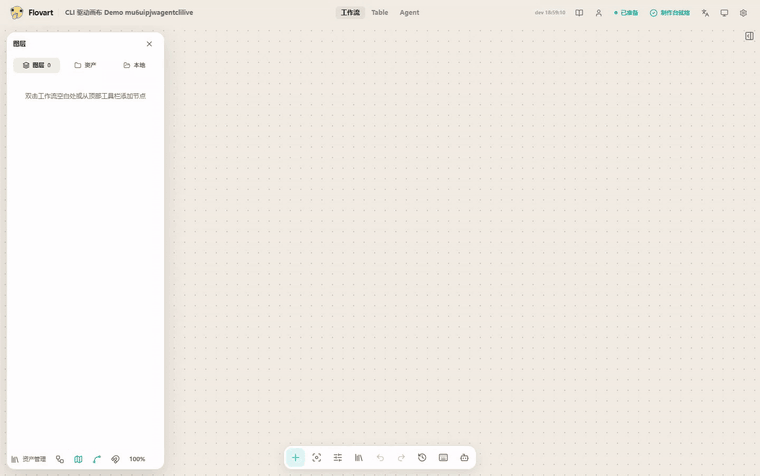
      <br /><sub><strong>Agent → live Workflow.</strong> Typed operations update the same visible project — no screen scraping.</sub>
    </td>
    <td align="center" width="50%">
      
      <br /><sub><strong>Prompt in place.</strong> Human and Agent work converge on the same editable surface.</sub>
    </td>
  </tr>
  <tr>
    <td align="center">
      
      <br /><sub><strong>Image operations.</strong> Local edits produce explicit, reusable results.</sub>
    </td>
    <td align="center">
      
      <br /><sub><strong>Video operations.</strong> Trim and other media tools run locally in the current workspace.</sub>
    </td>
  </tr>
</table>

**More real operation GIFs are in the [full feature tour](#feature-tour).**

**Jump to:** [Quick start](#quick-start) · [Feature tour](#feature-tour) · [Why Flovart?](#why-flovart) · [Core capabilities](#core-capabilities) · [Bring your own models](#bring-your-own-models) · [Compatibility](#integrations-and-compatibility) · [Architecture](#architecture) · [Local-first and security](#local-first-and-security) · [Roadmap](#creative-app-roadmap) · [Contributing](#contributing)

## Quick start

### For creators

1. Download a preview build from [GitHub Releases](https://github.com/avabbbb/Flovart/releases).
2. Open Flovart and add an AI service in Settings. For the Closed Beta, use RunningHub (image + video, Beta pending certification); other providers are Experimental.
3. Create or open a Workflow, add references, and start creating.

The Releases page may contain test or preview artifacts; it is not a claim that every host or provider is Stable.

### Known limitations (0.2.0 Closed Beta)

- Beta paths are Codex CLI + Browser Workflow (agent) and RunningHub image + video (provider, pending certification). Everything else, including DaVinci Resolve, WorkBuddy, Claude Code, OpenCode, Gemini and OpenAI-compatible BYOK, is Experimental.
- Builds are unsigned: Windows shows a SmartScreen warning (Authenticode is not configured) and macOS uses ad-hoc signing without notarization, so Gatekeeper asks for confirmation.
- Paid generations bill on the provider side. If you stop or reload during a generation, the provider may still charge; check your provider console before rerunning.
- Some generation error messages are still Chinese-only.
- Found a problem? Open a Beta feedback issue and attach the crash-log export (Copy diagnostics on the error screen).

### For coding-agent users

Run from a source checkout while the versioned CLI package remains a release gate:

```bash
git clone https://github.com/avabbbb/Flovart.git
cd Flovart
npm install
npm run flovart:cli -- start --source --web --open
npm run flovart:cli -- status --json
```

Then ask your local agent: **“Open Flovart and work on this Workflow.”**

Your agent learns Flovart through the **Agent Integration Skill** at `.agents/skills/flovart/` (mirrored for Claude under `.claude/skills/flovart/` and bundled for WorkBuddy under `integrations/workbuddy/flovart/skills/flovart/`). On a source checkout the harness auto-discovers it; the packaged CLI also ships it so `flovart ensure` can register it. This is a thin adapter — it teaches the agent the 5 operations below; it is not a Production Skill / Marketplace feature.

The normal agent loop is `status`, `workflow.inspect`, `workflow.selection.get`, `workflow.apply` and `workflow.node.run`. Connection setup and diagnostics use `ensure` and `doctor`; development-only browser checks are covered in the [Getting Started guide](docs/overview/quick-start.en.md).

## Feature tour

Every clip below is a real recording of the running app — one operation, start to finish, with no composited frames and no mockups. Each is cut to the action.

**Agent-native, not screen-scraping.** These are operations on the same Workflow an agent drives. The hero above and the CLI capture under [Architecture](#architecture) are agent-driven end to end, with no human input; the tour below is that same surface driven by hand, because that is the path a new user follows first. Node creation, connections, selection, viewport, node moves and resizes, and the node tools are all exposed to agents as typed operations — with revision and idempotency boundaries rather than coordinates on a screen.

Video and audio tools run ffmpeg.wasm in the browser; their core is pre-warmed before the recorded action, so the clip shows the operation rather than the one-off ~30MB wasm download — **clip length is therefore not the wait time on a first run**. Registration, method and limits: [DEMO_RECORDING.md](docs/archive/2026-10-07/maintenance/readme/DEMO_RECORDING.md).

### Canvas

<table>
  <tr>
    <td align="center">
      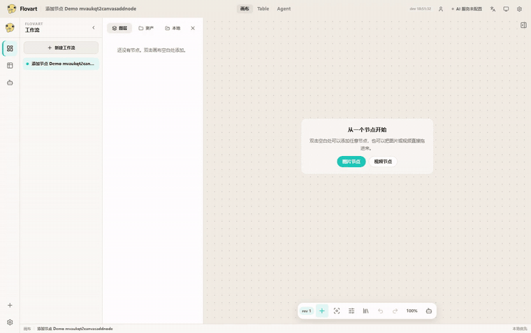
      <br /><sub><strong>Add nodes.</strong> The toolbar's add menu covers image, video, text, script, audio and config.</sub>
    </td>
    <td align="center">
      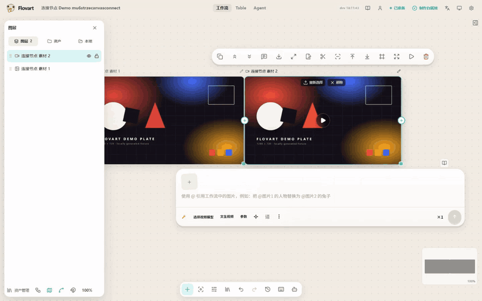
      <br /><sub><strong>Connect.</strong> Drag from a node's source handle onto another node to feed it in.</sub>
    </td>
  </tr>
  <tr>
    <td align="center">
      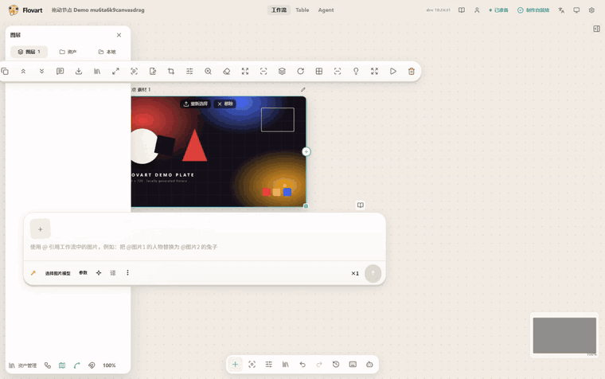
      <br /><sub><strong>Arrange by hand.</strong> Nodes move freely; the graph itself is the state.</sub>
    </td>
    <td align="center">
      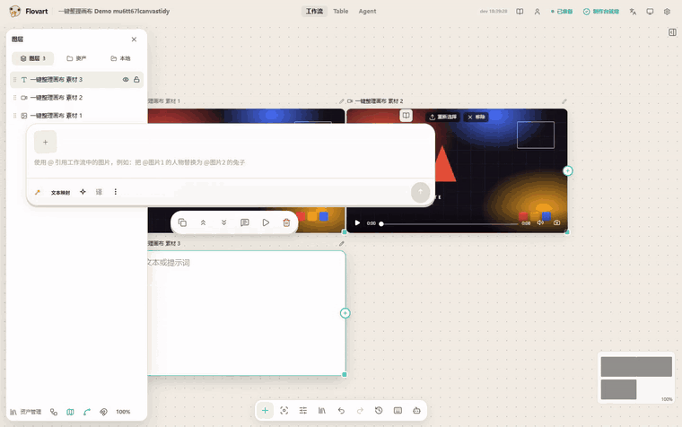
      <br /><sub><strong>Tidy.</strong> One click re-lays out the whole graph.</sub>
    </td>
  </tr>
  <tr>
    <td colspan="2" align="center">
      
      <br /><sub><strong>Prompt in place.</strong> Select a node and write the prompt on the node itself — no separate prompt dialog.</sub>
    </td>
  </tr>
</table>

### Image nodes

Four local operations on the same generated fixture plate, each producing a real result node. None of them contacts a model service.

<table>
  <tr>
    <td align="center">
      
      <br /><sub><strong>Crop.</strong> Set the crop rectangle, then apply.</sub>
    </td>
    <td align="center">
      
      <br /><sub><strong>Rotate and flip.</strong> Quarter turns and mirrors.</sub>
    </td>
  </tr>
  <tr>
    <td align="center">
      
      <br /><sub><strong>Split to grid.</strong> Each cell becomes its own connected image node.</sub>
    </td>
    <td align="center">
      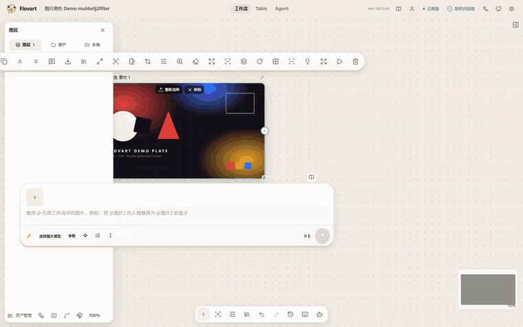
      <br /><sub><strong>Grade.</strong> Colour adjustments preview live before they are applied.</sub>
    </td>
  </tr>
</table>

### Video nodes

Also local, also without a model service: these run through the in-browser ffmpeg core, and each one creates its own result node (audio/video split creates two).

<table>
  <tr>
    <td align="center">
      
      <br /><sub><strong>Trim.</strong> Set the in/out points; the cut uses stream copy, so nothing is re-encoded.</sub>
    </td>
    <td align="center">
      
      <br /><sub><strong>Split audio and video.</strong> One video becomes a silent video node plus an audio node.</sub>
    </td>
  </tr>
  <tr>
    <td align="center">
      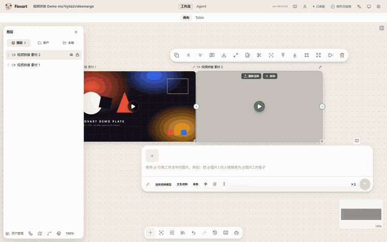
      <br /><sub><strong>Merge.</strong> Select several video nodes and join them in order.</sub>
    </td>
    <td align="center">
      
      <br /><sub><strong>Extract a frame.</strong> Pick a timecode and get an image node out of the video.</sub>
    </td>
  </tr>
  <tr>
    <td align="center">
      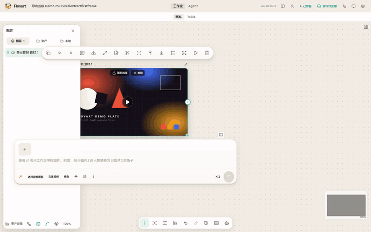
      <br /><sub><strong>First frame.</strong> One click, straight to an image node.</sub>
    </td>
    <td align="center">
      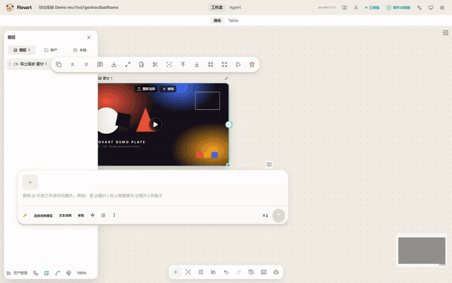
      <br /><sub><strong>Last frame.</strong> Same, from the tail of the clip.</sub>
    </td>
  </tr>
</table>

### Audio nodes

<table>
  <tr>
    <td align="center">
      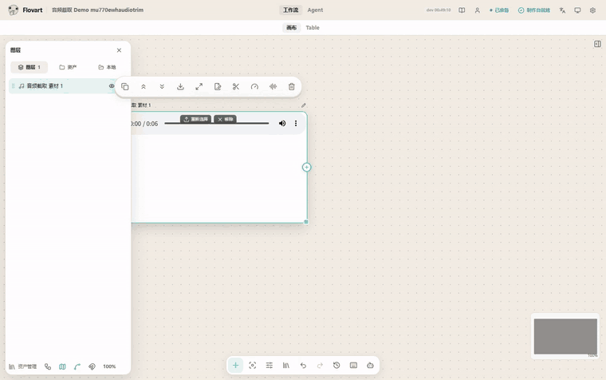
      <br /><sub><strong>Trim.</strong> Same in/out controls, same stream-copy cut.</sub>
    </td>
    <td align="center">
      
      <br /><sub><strong>Speed.</strong> 0.25×–4× with pitch preserved.</sub>
    </td>
  </tr>
  <tr>
    <td colspan="2" align="center">
      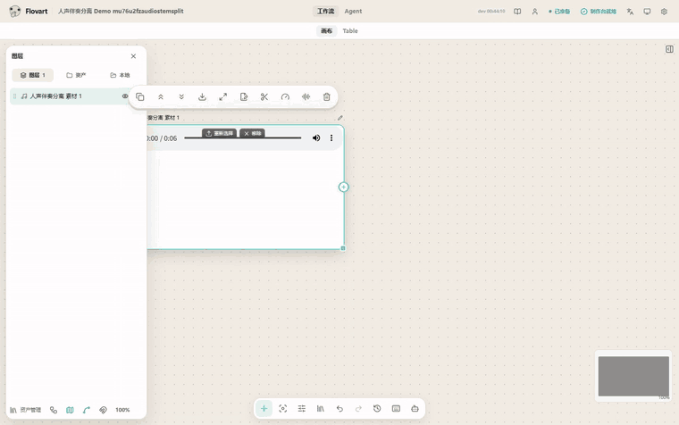
      <br /><sub><strong>Separate vocals and backing.</strong> Two audio nodes come out; this is stereo phase cancellation, so mono or heavily mixed material separates less cleanly.</sub>
    </td>
  </tr>
</table>

### The external-agent link

<table>
  <tr>
    <td align="center">
      
      <br /><sub><strong>Operations land on the canvas.</strong> Driven entirely by the agent — no human input — <code>workflow.node.create</code> and <code>workflow.connect</code> run through the typed CLI while the visible Workflow updates in place: no screen scraping, no hidden copy of the project.</sub>
    </td>
    <td align="center">
      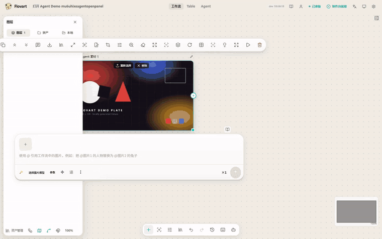
      <br /><sub><strong>Open the Agent surface.</strong> Reachable from the same canvas toolbar.</sub>
    </td>
  </tr>
</table>

Not filmed yet, and deliberately not shown: model-backed generation and the model-backed image tools (image generation, upscale, background removal, layer split, edit/outpaint) — this checkout configures no provider, so there is no honest result to record. That gap is logged in the [recording notes](docs/archive/2026-10-07/maintenance/readme/DEMO_RECORDING.md).

## Why Flovart?

Most AI creative tools ask you to move your work into another canvas. **Flovart goes the other way.**

Your professional editor remains the source of truth. Your Agent reads the creative context. Flovart manages generation, references, durable artifacts and reviewable candidates — and the full Flovart workspace opens only when the job actually needs a visual Workflow.

- **Inside the editor.** The first host path targets DaVinci Resolve Studio 21.1; other creative hosts remain Experimental until real-host validation.
- **Agent-native.** Agents act through typed Flovart capabilities and host-native control surfaces instead of mouse coordinates or screen scraping.
- **Non-destructive by default.** Generated work starts as a candidate. The Resolve-first P0 ends at **Add to Media Pool** before timeline replacement is considered.
- **Bring your own models.** RunningHub image + video is the Beta provider path (pending certification); other providers and OpenAI-compatible BYOK are Experimental.
- **Local-first.** Project-adjacent state, references and generated artifacts stay close to the creative workspace wherever the current implementation supports it.

The canvas is still a power surface for multi-shot work, complex references and reusable workflows. **It is no longer the product premise.**

## Core capabilities

| Capability | Flovart |
| --- | --- |
| Agent control | Typed operations against the actual visible Workflow |
| Human editing | The same graph, assets and results stay directly editable |
| Models | BYOK and multi-provider adapters, with capability-specific status |
| References | Graph connections, mentions, local assets and artifacts resolve into generation inputs |
| Automation | Explicit inspect/apply/run operations with revision and approval boundaries |
| Data | Local-first storage with documented browser and runtime boundaries |

Compose image, text, video, audio and configuration nodes, keep projects and references close to your workspace, and extend providers, hosts and node operations through explicit contracts. The top-level product surfaces are **Canvas** (the spatial Workflow), **Table** (structured media processing), and **Agent** (the local/external coding-agent connection hub). The built-in **Assistant / Context / History** stays in a contextual drawer beside Canvas/Table and is not duplicated inside Agent — see [Features](docs/content/docs/overview/features.en.mdx).

## One workflow, human + agent

```text
Your Agent                  Codex (Beta) · WorkBuddy, Claude Code (Experimental)
      │
      ▼
Flovart Operations             inspect · select · apply · run
      │
      ▼
Live Workflow  ──────────── Human
      │
      └──────────────────── Models
```

With your agent, a brief becomes explicit operations: it reads the current project and revision, applies them, and can run a confirmed node. By hand, you add, move, resize and connect nodes, drop in local files, configure a model, run generation and iterate visually. Both paths converge on the same Workflow authority, so nothing the agent does is invisible to you.

## Bring your own models

```text
Your provider → your API key → your assets + Workflow → your generated result
```

Flovart does not bundle model services. Configure a provider in the app, choose the capabilities and model you need, and keep the provider terms, cost and output rights in your own hands. OpenAI-compatible BYOK and remote-provider paths are Experimental: an adapter in the code is not a paid-provider certification. The Closed Beta certifies one paid provider path, RunningHub image + video, still Beta (pending certification) until certification completes.

## Integrations and compatibility

| Host or package | Status |
| --- | --- |
| Codex CLI + Browser Workflow | Beta |
| Claude Code CLI projection | Experimental |
| OpenCode CLI projection | Experimental |
| WorkBuddy CLI Connector | Experimental |
| CodeBuddy Code | Planned |
| Pi | Planned |
| Photoshop UXP panel | Experimental |
| Premiere Pro UXP panel | Experimental |
| After Effects | Experimental |
| DaVinci Resolve Studio | Experimental |

`Experimental`, `Planned` and External Gate items are not Stable claims. Evidence, boundaries and release gates live in the [Support Matrix](SUPPORT_MATRIX.md), which is the single source of truth; this table is not a second compatibility policy.

## Architecture

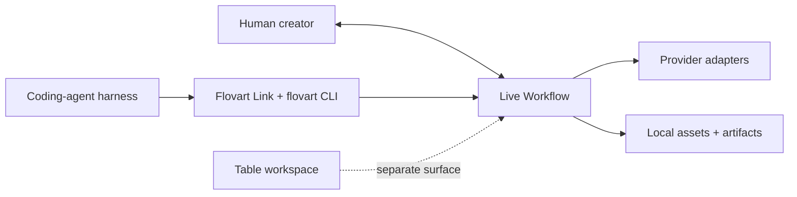

The existing `flovart` CLI name is a compatibility surface during the Flovart rebrand. CLI and the experimental stdio MCP share operation semantics and the current Browser Workflow binding. Deterministic operations do not require a second AI to reinterpret them.

<p align="center">
  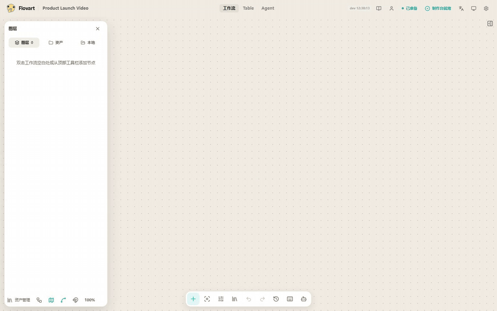
  <br />
  <sub><strong>The operation-level view of the same claim.</strong> A project and three nodes are created through
  <code>workflow.project.create</code>, <code>workflow.node.create</code> and <code>workflow.connect</code> (played at 1.5×) — the
  typed operations the external-agent session above drives end-to-end. Capture record:
  <a href="docs/archive/2026-10-07/maintenance/readme/DEMO_RECORDING.md">DEMO_RECORDING.md</a>.</sub>
</p>

Native-effect work keeps two short paths: one shared generation function produces durable media versions, and the host effect reads a fixed version and renders locally — no director/Operator/crew chain. Product scope and system boundaries live in the [main design](docs/design/00-overview.md); agent transport/authority details live in [Agent Integration](docs/design/12-agent.md). Historical target/current architecture reports no longer participate in product decisions.

## Local-first and security

- Projects, assets and generation history are stored primarily in the browser today; cloud sync is not promised.
- The current Web path stores API keys locally through the encrypted `localforage` vault, while the frontend calls the configured model service directly. Treat the browser as part of the secret boundary.
- Web, Desktop WebView and extension storage are normally isolated. Cross-entry synchronization through a restricted runtime bridge is still pending.
- Never put API keys in a prompt, log or repository. Agent and CLI paths receive redacted readiness and capability state, not raw credentials.
- Use only the repository, the [live demo](https://avabbbb.github.io/Flovart/) and desktop artifacts published by the repository's Actions as official project channels. Review each provider's terms and the rights for your inputs and outputs.

Found a vulnerability? Report it privately through the [security policy](SECURITY.md).

## Creative App Roadmap

The first creative-host direction is now **DaVinci Resolve Studio 21.1 first**.

The current product target is deliberately narrow:

```text
Current Resolve selection
→ Agent understands the task
→ Flovart creates a durable candidate
→ review
→ Add to Media Pool
```

The original timeline remains unchanged in P0. Adding a candidate to a new track is a later gate; Replace / Commit comes only after target revalidation and recovery behavior are proven. Resolve OFX is deferred until a real workflow demonstrates the need for host-persisted effect parameters, keyframes or offline effect rendering.

After Effects, Premiere Pro and Photoshop work remains Experimental and is not used to claim certified host support.

These are directions, not Stable support; follow [the roadmap](docs/content/docs/progress/todo.mdx), [pending verification](docs/content/docs/progress/pending-test.mdx) and the [Support Matrix](SUPPORT_MATRIX.md) for the evidence trail.

## Contributing

Contributions are especially useful in three areas: provider adapters, host integrations and Workflow capabilities. Open an [Issue](https://github.com/avabbbb/Flovart/issues/new/choose), read the [contribution conventions](.github/CONTRIBUTING.md), and include verification evidence with UI changes.

## Acknowledgements

Thanks to [@labiaaaaaaaaa](https://github.com/labiaaaaaaaaa) for driving third-party service compatibility and aggregation-endpoint fixes.

## License and disclaimer

Flovart is licensed under the [MIT License](./LICENSE). By using the project, you agree to the [Terms of Service](./docs/TERMS_OF_SERVICE.md) and [Privacy Policy](./docs/PRIVACY_POLICY.md).

Flovart does not bundle model services and makes no intellectual-property claim over generated content. You are responsible for the copyright, compliance and lawful use of your models, input assets and generated output. See [project data and statistics](stats/README.md).